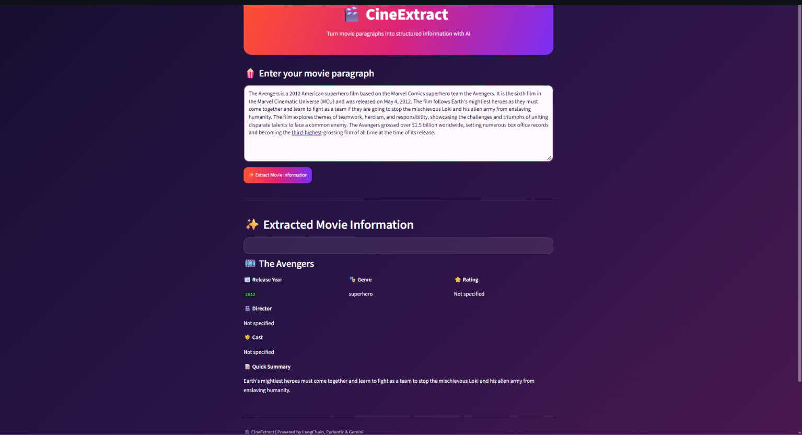
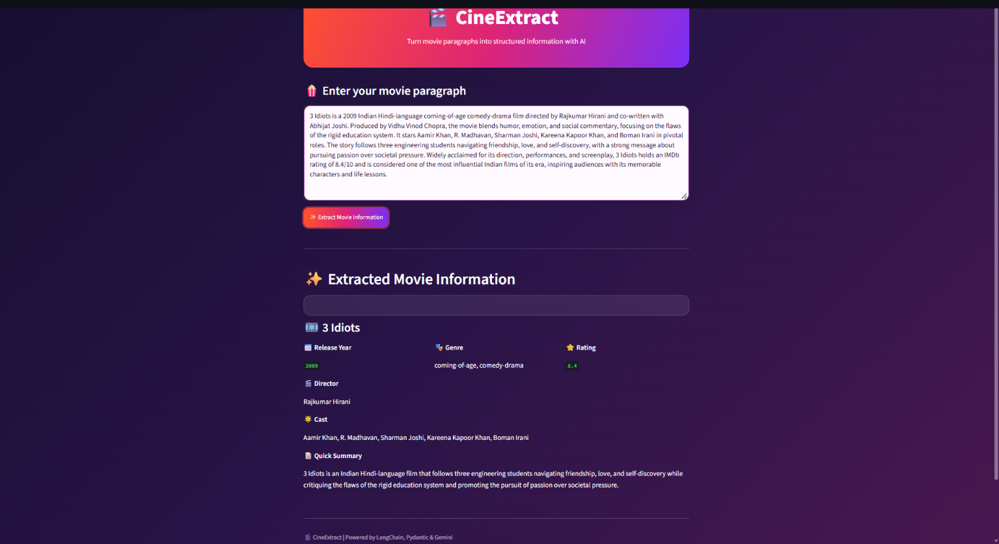

# 🎬 CineExtract — AI-Powered Movie Information Extraction

CineExtract is a movie-information extraction project built with **Python, Streamlit, LangChain, Google Gemini, and Pydantic**. It accepts a paragraph about a movie and uses an LLM to extract key details into a structured format, with a simple, cinema-inspired web interface.

The project also includes two command-line scripts that demonstrate the extraction workflow before and after adding a Pydantic schema and output parser.

## ✨ Features

- **Movie paragraph input:** Paste a paragraph describing a movie into the Streamlit app.
- **AI-powered extraction:** Uses Google Gemini through LangChain's `ChatGoogleGenerativeAI` integration.
- **Structured output:** Uses a Pydantic `Movie` schema and `PydanticOutputParser` to validate the model's response.
- **Key movie fields:** Extracts the title, release year, genres, director, cast, rating, and a short summary.
- **Custom Streamlit UI:** Gradient styling, a clear input area, extraction button, and formatted result fields.
- **API key from environment:** Reads `GEMINI_API_KEY` from a local `.env` file rather than hard-coding it in Python.

## 🧰 Tech Stack

| Technology | Purpose |
|---|---|
| Python | Main programming language |
| Streamlit | Web interface |
| LangChain | Prompt construction and model integration |
| Google Gemini | Movie paragraph analysis and information extraction |
| Pydantic | Defines and validates the movie data schema |
| `python-dotenv` | Loads the API key from `.env` |

## 📁 Project Structure

```text
CineExtract/
├── Demonstration_SS/
│   ├── 1.png
│   └── 2.png
├── .env                  # Local API key; do not commit this file
├── CineExtract_UI.py     # Main Streamlit application
├── core.py               # Basic prompt-based extraction script
├── core_updated.py       # Schema-based extraction using Pydantic
├── requirements.txt      # Python dependencies (create as described below)
├── .gitignore            # Files Git should ignore (recommended)
└── README.md
```

## ⚙️ Setup and Installation

### 1. Clone the repository

```bash
git clone https://github.com/YOUR_USERNAME/CineExtract.git
cd CineExtract
```

Replace the repository URL with your actual GitHub repository URL after creating it.

### 2. Create and activate a virtual environment (recommended)

**Windows PowerShell**

```powershell
python -m venv .venv
.\.venv\Scripts\Activate.ps1
```

If PowerShell blocks activation, you can run the environment's Python directly or use the activation method appropriate for your terminal.

### 3. Install dependencies

Create a `requirements.txt` file in the project root with:

```text
streamlit
python-dotenv
langchain-core
langchain-google-genai
pydantic
```

Then install the dependencies:

```bash
python -m pip install -r requirements.txt
```

These are the direct dependencies used by the supplied Python scripts. Package versions are intentionally not pinned in this basic setup.

### 4. Configure your Gemini API key

Create a file named `.env` in the project root, alongside `CineExtract_UI.py`:

```dotenv
GEMINI_API_KEY=your_gemini_api_key_here
```

Replace the example value with your own key. **Never publish your real API key or commit the `.env` file to GitHub.**

## 🚀 Run the Streamlit App

From the project root, run:

```bash
streamlit run CineExtract_UI.py
```

Streamlit will print a local URL in the terminal (usually `http://localhost:8501`). Open that URL in your browser.

## 🧪 How to Use

1. Start CineExtract with the command above.
2. Paste a paragraph containing information about a movie into the text area.
3. Select **✨ Extract Movie Information**.
4. Wait while the app sends the paragraph to Gemini.
5. Review the extracted fields displayed in the result section.

The Streamlit application currently displays these fields:

| Field | Description |
|---|---|
| `title` | Movie title |
| `release_year` | Release year, if present in the source paragraph |
| `genre` | One or more genres |
| `director` | Director, if identified |
| `cast` | Cast names identified from the paragraph |
| `rating` | Rating, if stated in the paragraph |
| `summary` | Short summary generated from the paragraph |

The model is instructed to avoid inventing details. Optional fields can be returned as `null`; absent list fields should be empty lists.

## 🧠 How It Works

1. **Load configuration:** `python-dotenv` loads `GEMINI_API_KEY` from `.env`.
2. **Accept input:** The Streamlit UI collects a movie paragraph.
3. **Build the prompt:** `ChatPromptTemplate` combines the system instructions, paragraph, and Pydantic parser format instructions.
4. **Call Gemini:** `ChatGoogleGenerativeAI` sends the prompt to the configured Gemini model (`gemini-3.5-flash-lite` in the current code).
5. **Parse the response:** `PydanticOutputParser` parses and validates the response against the `Movie` schema.
6. **Display results:** Streamlit displays the extracted fields in the UI.

### The Pydantic schema

The current UI defines a `Movie` model with these fields:

```python
class Movie(BaseModel):
    title: str
    release_year: Optional[int] = None
    genre: List[str]
    director: Optional[str] = None
    cast: List[str]
    rating: Optional[float] = None
    summary: str
```

## 🖼️ Screenshots

The screenshots below are expected to be stored in the `Demonstration_SS` folder.

### Screenshot 1



### Screenshot 2



GitHub displays these images when the filenames and folder structure match the paths above.

## 🧩 Additional Scripts

- **`core.py`** — A command-line version that asks for a movie paragraph and prompts the model to return a broader set of details, including main characters, language, country, runtime, production company, music director, plot summary, and themes. This script uses a text prompt rather than the Pydantic schema.
- **`core_updated.py`** — A command-line version that defines the `Movie` Pydantic schema and uses `PydanticOutputParser` to request structured output.
- **`CineExtract_UI.py`** — The main Streamlit application, combining the schema-based extraction workflow with a browser-based UI.

Run the main UI using the Streamlit command above. The other scripts are included as examples of the project's development.

## ⚠️ Notes and Limitations

- The model can make mistakes. Review extracted information before relying on it.
- Extraction quality depends on the detail and accuracy of the paragraph supplied.
- If a field is not present in the paragraph, the result may be missing or marked as unspecified.
- The configured Gemini model must be available to your API key and account. If Gemini reports that the model is unavailable, update the model name to one supported by your account.
- API availability, quotas, and billing limits are controlled by Google and may affect requests.
- The current schema is limited to seven fields: title, release year, genre, director, cast, rating, and summary. The broader list in `core.py` is not displayed by the Streamlit UI.

## 🛠️ Troubleshooting

### `GEMINI_API_KEY not found`

- Confirm that `.env` is in the project root beside `CineExtract_UI.py`.
- Check that the variable is named exactly `GEMINI_API_KEY`.
- Restart Streamlit after changing the `.env` file.

### Model not found or API request fails

- Confirm the model name configured in `CineExtract_UI.py` is available to your Google AI API key.
- Check your internet connection, API quota, and Google AI API settings.

### Pydantic parsing or validation error

The parser expects the response to match the `Movie` schema. If the model returns malformed structured output or omits required fields, parsing may fail. Review the error message and the model response, and confirm that the prompt includes the parser's format instructions.

### Screenshot images do not appear on GitHub

Confirm that the files are named exactly `1.png` and `2.png` and are committed under `Demonstration_SS/`.

## 🔐 Security

Before pushing the project to GitHub, add a `.gitignore` file in the project root with at least:

```gitignore
.env
.venv/
venv/
__pycache__/
*.py[cod]
```

If `.env` has already been committed, adding it to `.gitignore` does not remove it from Git history. Remove it from tracking and rotate the exposed API key if it was pushed publicly.

## 📌 Future Scope

Possible future improvements—**not currently implemented**—could include expanding the Pydantic schema, adding stronger structured-output handling, and deploying the Streamlit application.

---

**CineExtract** — Movie information extraction with Python, LangChain, Gemini, Pydantic, and Streamlit.
